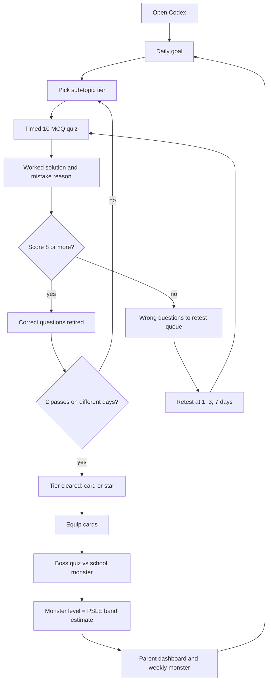

# Cookie Codex: PSLE Quiz Game and Retention Design

Design only. Audience: a Primary 6 student (PSLE 2027) and a parent. The game exists to get daily, correct practice. Locked decisions (localStorage only, 10-MCQ quizzes, retire-on-correct, per-topic JSON banks) are taken as given.

## 1. Core loop

The student opens the Codex, sees today's goal, and picks a sub-topic in one of four Schools of Mastery. They take a timed 10-question quiz and see a worked solution plus the reason behind their chosen wrong option after every answer. Correct questions retire; wrong ones enter a spaced retest queue. Passing a tier (Basic, Intermediate, Competent) earns a cookie card shown in advance. Cards give small boosts in a mixed-topic boss quiz against a school's monster, whose level is the student's estimated PSLE band. Boss results and mistake tags feed next week's monster and the parent's dashboard.



## 2. Schools and levels

Four schools (English, Chinese, Math, Science) hold 12, 12, 31 and 35 sub-topics: 90 levels, 270 tiers. **All four schools are open from day 1**, so the student can switch subject on a bad day and still meet the goal.

Ordering within a school:
- A sub-topic's **home level** is the highest P-level tag among its outcomes (the level it must be mastered at). Sort by home level (P1 to P6), then syllabus order. English is P5-P6 and Chinese P6 throughout, so they follow syllabus order.
- **Band gate:** a P-band opens when 60% of the previous band's sub-topics have Basic passed. P1-P3 content is quick revision, not a wall.
- **Prerequisite inside a topic:** sub-topic n+1 opens when sub-topic n has Intermediate passed. The first sub-topic of every topic is open once its band is.
- **Tier order:** Intermediate needs Basic, Competent needs Intermediate.
- The parent can "unlock all" for a school.

## 3. Tier rules

| | Basic | Intermediate | Competent |
|---|---|---|---|
| Pass | 8/10 on two quizzes, different calendar days | same | same |
| Time limit | 12 min (1.2 min/Q, 1-mark MCQ pace) | 15 min (1.5 min/Q) | 20 min (2 min/Q, multi-step, 2-mark pace) |
| Chinese | +25% (reading load) | | |

Paper 1 MCQs run about 1-2 minutes; Paper 2 long questions 3-5 minutes. A 10-MCQ quiz cannot test Paper 2 pacing, so Competent uses the top of the MCQ range and the boss quiz carries "PSLE style" pressure. A parent switch gives x1.5 time for accessibility.

- **Pass details:** the two passing quizzes use disjoint questions; the second must be on a later day. Passes need not be consecutive. A timeout marks unanswered questions wrong with the tag `ran_out_of_time`.
- **Fail:** nothing is lost. Wrong questions go to the retest queue, and the result screen says "next time, aim for these three". Up to 3 attempts per tier per day (the daily cap still applies). After two fails under 5/10 the screen suggests re-reading the worked solutions and trying the lower tier.
- **Retest mixing:** each tier quiz includes up to 3 due retest questions from the same sub-topic (never more than 30%), replacing new ones. Due items from other sub-topics go into a 5-question **Daily Review** that counts toward the goal but never toward a pass.
- **Retest steps:** wrong -> due in 1 day; correct at step 1 -> 3 days; correct at 3 -> 7 days; correct at 7 -> retired for good. A wrong answer at any step returns to step 1.
- **Thin pools:** a tier is playable only if it has at least 20 unretired questions. If fewer than 10 remain mid-way, the tier fills from its retest queue; if that is empty, the tier is auto-credited.

## 4. Card economy

### The constraint and the deviation

There are 186 cookies and about 270 tier completions. A literal "Basic = common, Intermediate = rare, Competent = legendary" runs out after 7 commons. I **deviate from the literal mapping** and say so plainly:

- Each tier maps to a **rarity class**, not one rarity. The first seven Basic rewards are literally the 7 commons, so the opening matches the user's idea.
- Only **11 of 90 Competent** rewards are legendaries (placed at topic capstones, the last sub-topic of a topic; super-epics go to other capstones). The rest of the Competent class is epic and super-epic.
- **Why:** 116 of the 186 cookies are epic. Ignoring them wastes 62% of the pool, and 11 legendaries can serve 90 Competent tiers only as milestones. Rarity still rises with tier.

### Reward pool (172 cards by tier, plus 14 milestone cards)

| Tier class | Pool | Distinct cards | Slots (one per sub-topic) | Duplicate slots |
|---|---|---|---|---|
| Basic | 7 common + 11 special + 40 epic | 58 | 90 | 32 |
| Intermediate | 14 rare + 50 epic | 64 | 90 | 26 |
| Competent | 26 epic + 13 super-epic + 11 legendary | 50 | 90 | 40 |
| Milestones | 5 ancient + 2 dragon + 6 beast + 1 witch | 14 | n/a | n/a |
| **Total** | | **186** | **270** | 98 |

Cards are split by school so each school has its own deck and so a Math-only MVP draws from a consistent set:

| School | Sub-topics | Basic new | Inter. new | Comp. new | New total | Star slots |
|---|---|---|---|---|---|---|
| Math | 31 | 20 | 22 | 17 | 59 | 34 |
| Science | 35 | 22 | 24 | 19 | 65 | 40 |
| English | 12 | 8 | 9 | 7 | 24 | 12 |
| Chinese | 12 | 8 | 9 | 7 | 24 | 12 |
| **Total** | 90 | 58 | 64 | 50 | **172** | 98 |

Epics used: Math 40, Science 44, English 15, Chinese 17 = 116. All of them are used.

### Fixed, previewed rewards (no loot boxes at all)

A build script generates `site/src/data/rewards.json` with a seeded shuffle: every (sub-topic, tier) maps to one card, and the sub-topic page shows it before the quiz ("Clear Basic to earn Pure Vanilla Cookie"). **There is no randomness and no loot box.** Duplicate slots are spread evenly through each tier's sequence, never before slot 6, and each is pinned to a card of the same class already earned in that school.

### Duplicates: stars

A duplicate slot gives **+1 star** to that card (max 5 stars, the cost is more training, never money). Stars matter because they raise power.

### Milestone cards (earned by behaviour, not tiers)

| Card | Unlock | Learning purpose |
|---|---|---|
| Ancient (5) | Ancient n unlocks when 2n legendaries are owned at 2 stars or more (2, 4, 6, 8, 10), then pass a 10-Q Competent "Ancient Trial" (9/10, 20 min) | Rewards depth across schools |
| Dragon (2) | 30 and 100 study days (a day counts when the goal is met; need not be consecutive) | Rewards consistency without punishing breaks |
| Beast (6) | First win vs each school monster (4), 10 and 25 weekly monsters won (2) | Rewards facing weak spots |
| Witch (1) | Correct 150 questions from the retest queue at step 3 or 7 | Rewards fixing past mistakes |

### Card skills

**Power = round(accuracy x star bonus)**, capped at 100. Accuracy is the average of the student's best two passing quizzes on the tier that earned the card; star bonus is 1 + 0.05 x (stars - 1). So power is mastery, not luck. Retraining a tier (retest queue practice) updates accuracy. A card's boost type comes from its tier class: Basic = **+time**, Intermediate = **hint** (hide one wrong option), Competent = **shield** (first wrong answer not counted). Power below 60 gives +15 s, 60-84 gives +30 s or the standard effect, 85 or more hides two options for hint cards.

### Does the pool last to PSLE?

PSLE written exams are expected around late Sept/early Oct 2027 (confirm against the SEAB circular). From 17 Nov 2026 to 30 Sep 2027 is 317 days; at 5 study days a week that is about 226 active days.

- A tier costs about 36 minutes: 3 quizzes (2 passes plus 1 fail on average) at 12 minutes each including review.
- 80% of time goes to tiers; 20% goes to daily review and weekly bosses.

| Minutes/day | Tiers cleared by 30 Sep | Distinct cards (about 64%) | Stars |
|---|---|---|---|
| 20 | 100 | 64 | 36 |
| 25 | 125 | 80 | 45 |
| 30 | 150 | 96 | 54 |

Even at 30 minutes a day, 76 of the 172 tier cards are unseen at PSLE time; the pool does **not** run out. Counting milestone cards, expect one to two Ancients at 25 minutes a day; Ancients 3 to 5 are long-term goals past PSLE. Clearing all 270 tiers would take about 40 minutes a day.

## 5. Monsters

A **monster** is a boss standing for the student's current competency in a school. Each school has 8 monsters, one per PSLE Achievement Level (AL8 weakest to AL1 strongest). The student always challenges the monster **one band above** their current estimate.

- **Challenge:** a boss quiz is 10 timed MCQs drawn from unretired questions and due retests across the school's cleared sub-topics. Higher monsters use more Competent-tier questions. Time limit 15 min, 20 for Competent-heavy monsters. Win threshold: 6/10 for AL8-AL6, 7/10 for AL5-AL3, 8/10 for AL2, 9/10 for AL1.
- **Cards:** up to 3 equipped, one boost per type, each used once per fight. A student with no cards can still win.
- **Level means a band:** estimated % = recent boss accuracy (last 5, weighted to the harder questions). AL1 >=90%, AL2 85-89, AL3 80-84, AL4 75-79, AL5 65-74, AL6 45-64, AL7 20-44, AL8 <20. The parent sees "Math monster: AL4 (MCQ skills)". Because MCQs cover about 26 of 100 Math marks and the game cannot test Paper 2, the label is "estimated, not a prediction".
- **Monster of the Week:** each Monday the app takes the 14-day data, picks the 4 sub-topics with lowest accuracy (at least 10 answers each) and the top 3 mistake tags, and builds a boss with at least 6 of 10 questions from them plus 2 retests. Winning gives +1 star and counts toward the Beast cards.

## 6. Return loop

| Hook | How it works | How it serves learning |
|---|---|---|
| Daily goal | 2 quizzes or 20 minutes (parent-set), any school | Fixes a spaced, manageable dose |
| Streak with forgiveness | Counts goal-met days; 1 automatic freeze a week; rest days never break it. If it breaks, show "best streak" and total study days, no cards lost | Consistency without anxiety |
| Spaced retest | 1, 3, 7 days | Targets forgetting curve |
| Monster of the Week | Built from weak spots | Practice goes where marks are lost |
| PSLE countdown | Shows weeks left and a pace plan ("N tiers left, about X per week") | Turns anxiety into a plan |
| Preview rewards | Card visible before clearing | Motivation without chance |

**Hard rules for a children's product:**
- No payments and no random-purchase mechanics, ever.
- **No loot boxes at all** (not even with disclosed odds). Every outcome is deterministic and previewed.
- No leaderboards, no public comparison, no shaming copy ("You failed" is replaced by "Not yet").
- Losing a streak removes nothing the student owns.
- **No infinite play:** the parent sets a daily session cap (default 45 minutes, range 15 to 90). The quiz in progress finishes, then the app shows **"Done for today"** and offers only the Codex and collection.
- No notifications, no timed rewards, and no "limited-time" events.

## 7. Parent view

PIN-gated (a convenience, not security). Sections:
- **Mastery:** school x sub-topic x tier grid (locked, in progress, cleared) plus monster band per school.
- **Accuracy trend:** 30-day line, per school.
- **Time spent:** minutes per day, weekly total versus cap.
- **Streak:** current, best, study days.
- **Mistakes:** top recurring `tag` values in plain English (via `site/src/data/quiz/tagLabels.json`; fallback humanises the snake_case), with their sub-topics. In real data `miscounted_units` ("counted the ratio units wrongly") dominates Ratio with 213 occurrences, followed by `reversed_order` ("wrote the ratio the wrong way round", 65) and `gave_other_person` ("answered for the wrong person", 64).
- **Retest queue:** list of due and upcoming questions with their step.
- **Settings:** set or change PIN, daily cap, extra-time switch, daily goal, PSLE date, unlock-all.
- **Backup:** Export/Import save code (see section 8).

## 8. localStorage schema

All access goes through `site/src/lib/store.ts`, which exposes `load()`, `save()` and `subscribe()` on a `StorageAdapter` interface, so a backend can replace it later. One atomic key, `ccx:save`, plus `ccx:backup` (last pre-migration copy).

```ts
interface SaveV1 {
  schemaVersion: 1;
  createdAt: number;                 // epoch ms
  settings: { pinHash: string | null; dailyCapMin: number; dailyGoalQuizzes: number;
              extraTime: boolean; unlockAll: Record<School, boolean>; psleDate: string };
  progress: Record<string /*subtopicId*/, { b: TierState; i: TierState; c: TierState }>;
  questions: Record<string /*qid*/, { s: 0|1|2|3|4; due: number; w: number }>; // s: 0 retired, 1-3 retest steps, 4 new wrong
  cards: Record<string /*slug*/, { stars: number; srcSub: string; srcTier: 'b'|'i'|'c'; acc: number }>;
  milestones: { ancient: string[]; dragon: string[]; beast: string[]; witch: boolean };
  monsters: Record<School, { band: number; recent: number[]; wins: string[] }>;
  weekly: { weekId: string; sub: string[]; tags: string[]; won: boolean } | null;
  attempts: Array<{ id: string; ts: number; mode: 'tier'|'boss'|'review'; sub?: string;
                    tier?: 'b'|'i'|'c'; score: number; ms: number; tags: string[] }>;
  days: Record<string /*YYYY-MM-DD*/, { quizzes: number; min: number; correct: number; total: number }>;
  streak: { current: number; best: number; freezeUsedWeek: string | null; studyDays: number };
}
type TierState = { passes: string[]; best: number; cleared: boolean }; // passes: dates
```

**Size estimate:** about 30 bytes per answered question x 5,000 = 150 KB; 1,000 attempts x 130 B = 130 KB; 365 days x 80 B = 30 KB; cards under 10 KB. Total about 350 KB, roughly 7% of the 5 MB quota (still under 15% if the quota counts UTF-16 bytes). The save code is JSON, deflated with `CompressionStream` and base64url, prefixed `CCX1:`, about 60-90 KB. Offer both copy and file download.

**Migration:** `schemaVersion` plus a `migrations: Record<number, (s) => s>` chain runs on load, after copying the old save to `ccx:backup`. An import with a newer version is refused with a clear message. Never delete unknown fields.

## 9. Page map

| Route | Purpose |
|---|---|
| `/` (existing) | Add "Today" card: goal ring, streak, continue button |
| `/train/` | Four schools, progress and monster band |
| `/train/[school]/` | Sub-topic map: locked, open, tier state |
| `/train/[school]/[subtopic]/` | Three tiers, rules, reward preview, start button |
| `/quiz/` | Single client page for tier, boss and review quizzes (mode via query) |
| `/collection/` | All 186 cards: owned, stars, power; milestones |
| `/monsters/` | Eight monsters per school, weekly monster, equip cards |
| `/parent/` | PIN-gated dashboard and settings |
| `/cookie/[slug]` (existing) | Owned or locked badge with stars and power; locked pages show "Earn this card: Math > Ratio > Basic" from `rewards.json` |

The index shelf gets an "owned only" toggle and a small owned badge. Locked cookies stay browsable, so the Codex remains an encyclopedia. Question banks are fetched lazily, one topic file (about 200-300 KB) per quiz.

## 10. MVP cut (Math only)

**Ships:**
- The Today card, `/train/`, `/train/math/`, sub-topic pages, `/quiz/`, `/collection/`, `/parent/`.
- Storage module, save code, PIN and daily cap.
- Tier pass rules, retest queue with 1/3/7-day steps, Daily Review.
- Math rewards (59 cards plus 34 star slots), stars, card power.
- Streak, freeze, daily goal, "Done for today".
- Parent mastery grid, mistake tags, retest queue.

**Playable content:** Ratio (100/100/100 per tier) and Fractions (multiplication and division: 50/66/100 by outcome count). Fraction of a whole and of a set is playable from Intermediate (basic has 16, under 20). Other Fractions sub-topics have 17 or fewer or none in some tiers. Because questions are counted by outcome tag, unique counts must be verified. Expect roughly **2 weeks of daily play** before Math content runs out, so bank generation is the critical path.

**Deferred:** Science, English and Chinese banks; monsters and boss quizzes (a single Math monster is the first follow-up); weekly monster; milestone cards; PSLE countdown planner; Ancient Trial; art for monsters.

## 11. Open questions

1. **Daily cap default?** Recommend 45 minutes, goal 2 quizzes.
2. **PSLE date for the countdown?** Recommend a parent-editable default of 30 Sep 2027, shown as "about N weeks".
3. **Is the Basic-to-common deviation acceptable?** Recommend yes (class mapping with first 7 Basics literally common).
4. **Should Chinese and English MCQs get extra time?** Recommend +25% for Chinese, none for English.
5. **Monster art?** Recommend simple SVG silhouettes now; no cookie images repurposed as monsters.
