# Past papers: repository, competency model and learning loop (design, Part 1)

Status: design only, drafted 19 Nov 2026. Nothing here is built. Build prompts follow after the owner approves it.

Part 1 covers everything that does not need the question database. Part 2 runs after two or three years of all four subjects are merged. It fills the `> Part 2:` placeholders and revises Part 1 where the data disagrees.

**Scope.** The inputs are P6 Maths, Science, English and Chinese past papers, 2018-2026: 36 compiled books, about 35,000 scanned pages. They are commercial and copyrighted. They stay outside git and outside the website. Drills on the site are original items modelled on the papers; they pass the same blind-answer and fact-check review gate as every other bank item.

**Figure 1.** The whole pipeline and loop.



Source: [`img/past-papers-flow.mmd`](img/past-papers-flow.mmd). Rebuild with `docs/img/render.sh`. The figure is described in section 6.

---

## 1. Repository

### 1.1 What the extraction files actually contain

Read from the 2026 pilot output under `/data/alvin/tmp/cookie-codex/pastpapers/<subject>/<year>/`. Field names only.

| File | One row is | Fields seen |
|---|---|---|
| `papers.jsonl` | one school paper | `paper_id` (`mat-2026-001`), `subject`, `year`, `school`, `school_guessed`, `exam`, `title`, `flags`, `parts`, `first_page`, `last_page`, `answer_pages`, `sec_marks` (list of `[part-index, count, marks-each, part]`), `file` (the source book), `questions` (count), `marks_by_part` |
| `questions.jsonl` (step A) | one question as OCR saw it | `id`, `subject`, `year`, `paper`, `school`, `exam`, `part`, `section`, `qno`, `format` (`mcq`, `structured`, `open`, plus `match` in Chinese), `marks`, `marks_source`, `pages`, `text`, `figures`, `flags`, `syllabus` (null: step B fills it); Chinese adds `group` and `passage` |
| `passages.jsonl` (Chinese; English likewise) | one reading or cloze passage | `id`, `paper`, `section`, `group`, `pages`, `text`, `figures` |
| `vlm32/pNNNN.json` | one page read by the VLM | `page`, `kind`, `school`, `exam`, `part`, `section`, `questions[]` (`qno`, `sub`, `text`, `options`, `marks`, `figure`), `answers[]` (`qno`, `sub`, `answer`) |
| `merged.jsonl` | one question after step A and VLM are reconciled | `id`, `paper`, `school`, `exam`, `qno`, `part`, `section`, `format`, `marks`, `marks_from` (`vlm_printed` or `stepA`), `stepA_marks`, `text`, `options`, `figures`, `pages`, `parts` (number of sub-parts), `flags` (`stepA_only`, `vlm_only`) |

Facts that shape the schema (pilot, `merged.jsonl` for maths/2026 and chinese/2026):
- A question has up to three competing sources for each value (step A, VLM, later step B), so provenance is stored per value, not per row.
- `marks` is a float in `merged.jsonl` and a string in step A; `marks_from` says which was used. Marks need their own source column.
- `options` is a list of strings carrying their `(n)` prefix. Store the label and the text apart.
- Most pilot rows are `stepA_only` because only a few papers have VLM data yet. The full VLM run (about 14.5 GPU-hours) will change that; the schema must treat "VLM missing" as normal.
- The answer key sits on separate pages (`answer_pages`) and arrives in the VLM `answers[]`, keyed by `qno` plus optional `sub`.
- A question can belong to a passage group (Chinese cloze and reading, English comprehension and cloze).

### 1.2 SQLite schema

One database, `pastpapers.sqlite`, rebuilt from JSONL. Foreign keys on. Every table with a paper has `paper_id` so a paper's rows can be dropped in one statement. The DDL below is the contract; names can change at build time, columns may not be dropped.

```sql
PRAGMA foreign_keys = ON;

-- Taxonomies, loaded from the repo's own JSON so tags can be joined and checked.
CREATE TABLE syllabus_node (            -- site/src/data/syllabus/<subject>.json
  node_id   TEXT PRIMARY KEY,           -- the outcome / sub-topic id used by the game
  subject   TEXT NOT NULL,
  level     TEXT NOT NULL CHECK (level IN ('strand','topic','subtopic','outcome')),
  parent_id TEXT REFERENCES syllabus_node(node_id),
  title     TEXT NOT NULL,
  p_level   INTEGER                      -- highest P-level of its outcomes (1-6)
);
CREATE TABLE pattern (                   -- scripts/quiz/<subject>/patterns.json
  pattern_id TEXT PRIMARY KEY,           -- e.g. a math-pat-... id
  subject    TEXT NOT NULL,
  label      TEXT NOT NULL,
  in_bank    INTEGER NOT NULL DEFAULT 0  -- refreshed by the loader from the game banks
);
CREATE TABLE method_tag (                -- the scheme in section 3
  tag_id  TEXT PRIMARY KEY,
  subject TEXT NOT NULL,
  scheme  TEXT NOT NULL,                 -- 'heuristic' | 'cer' | 'grammar_rule' | 'reading_skill'
  label   TEXT NOT NULL
);

-- Where the data came from.
CREATE TABLE book (
  book_id    TEXT PRIMARY KEY,           -- stable short id for one compiled PDF
  subject    TEXT NOT NULL,
  year       INTEGER NOT NULL,
  file_name  TEXT NOT NULL,              -- the `file` field of papers.jsonl
  sha256     TEXT NOT NULL,
  page_count INTEGER
);

CREATE TABLE paper (
  paper_id      TEXT PRIMARY KEY,        -- 'mat-2026-001'
  book_id       TEXT NOT NULL REFERENCES book(book_id),
  subject       TEXT NOT NULL,
  year          INTEGER NOT NULL,
  school        TEXT,
  school_guessed INTEGER NOT NULL DEFAULT 0,
  exam          TEXT,                    -- 'Prelim', 'SA2', ...
  title         TEXT,
  first_page    INTEGER, last_page INTEGER,   -- page numbers inside the book
  answer_pages  TEXT,                    -- JSON array
  marks_total   REAL,                    -- printed total if found
  marks_total_src TEXT                   -- 'cover' | 'sum_of_sections' | 'human'
);
CREATE TABLE paper_part (                -- "Paper 1/Booklet A", "Paper 2", ...
  part_id   INTEGER PRIMARY KEY,
  paper_id  TEXT NOT NULL REFERENCES paper(paper_id) ON DELETE CASCADE,
  name      TEXT NOT NULL,
  n_questions INTEGER, marks REAL,
  marks_src TEXT                         -- 'section_instruction' | 'vlm_printed' | 'human'
);

CREATE TABLE passage (
  passage_id TEXT PRIMARY KEY,           -- 'chi-2026-001-...-2'
  paper_id   TEXT NOT NULL REFERENCES paper(paper_id) ON DELETE CASCADE,
  section    TEXT, grp TEXT,
  pages      TEXT,                       -- JSON array
  body       TEXT                        -- stays in the DB only, never in the repo
);

CREATE TABLE question (
  question_id TEXT PRIMARY KEY,          -- the merged `id`
  paper_id    TEXT NOT NULL REFERENCES paper(paper_id) ON DELETE CASCADE,
  part_name   TEXT, section TEXT,
  qno         TEXT NOT NULL,
  passage_id  TEXT REFERENCES passage(passage_id),
  format      TEXT NOT NULL CHECK (format IN ('mcq','structured','open','match')),
  marks       REAL,
  marks_src   TEXT,                      -- 'vlm_printed' | 'stepA' | 'section_instruction' | 'human'
  marks_stepA REAL,                      -- kept to measure disagreement
  stem        TEXT,                      -- chosen text; competing readings live in question_value
  n_parts     INTEGER NOT NULL DEFAULT 1,
  pages       TEXT,                      -- JSON array of book page numbers
  read_state  TEXT NOT NULL,             -- 'stepA_only' | 'vlm_only' | 'both'
  position    INTEGER                    -- order within the paper
);
CREATE INDEX question_paper ON question(paper_id);

CREATE TABLE question_part (             -- (a), (b), ... of a structured question
  question_id TEXT NOT NULL REFERENCES question(question_id) ON DELETE CASCADE,
  sub         TEXT NOT NULL,
  stem        TEXT, marks REAL, marks_src TEXT,
  PRIMARY KEY (question_id, sub)
);
CREATE TABLE option (
  question_id TEXT NOT NULL REFERENCES question(question_id) ON DELETE CASCADE,
  label       TEXT NOT NULL,             -- '1'..'4' or 'A'..'H'
  body        TEXT,
  PRIMARY KEY (question_id, label)
);
CREATE TABLE figure (
  figure_id   INTEGER PRIMARY KEY,
  question_id TEXT REFERENCES question(question_id) ON DELETE CASCADE,
  passage_id  TEXT REFERENCES passage(passage_id) ON DELETE CASCADE,
  page        INTEGER, bbox TEXT,        -- JSON [x0,y0,x1,y1] on the rendered page
  crop_path   TEXT,                      -- file under the data root, never in the repo
  kind        TEXT                       -- 'diagram' | 'graph' | 'table' | 'photo' | 'visual_text'
);

-- Answer key and model answers. Answers from the school key and from an LLM never share a row.
CREATE TABLE answer (
  answer_id   INTEGER PRIMARY KEY,
  question_id TEXT NOT NULL REFERENCES question(question_id) ON DELETE CASCADE,
  sub         TEXT NOT NULL DEFAULT '',
  value       TEXT,                      -- the final answer as printed
  working     TEXT,                      -- marker's working or rubric text if printed
  origin      TEXT NOT NULL CHECK (origin IN ('school_key','llm_solution','human')),
  review      TEXT NOT NULL DEFAULT 'unreviewed'
              CHECK (review IN ('unreviewed','agrees_with_key','disputed','accepted','rejected')),
  page        INTEGER,
  UNIQUE (question_id, sub, origin)
);

-- Tags: one row per (question, taxonomy, value, source). Several sources may disagree.
CREATE TABLE tag (
  question_id TEXT NOT NULL REFERENCES question(question_id) ON DELETE CASCADE,
  taxonomy    TEXT NOT NULL CHECK (taxonomy IN ('syllabus','pattern','method')),
  ref_id      TEXT NOT NULL,             -- node_id / pattern_id / tag_id
  source      TEXT NOT NULL CHECK (source IN ('stepA','vlm','stepB','human')),
  confidence  REAL,                      -- 0-1; NULL when the source gives none
  run_id      TEXT,                      -- which step-B run, model and prompt version
  PRIMARY KEY (question_id, taxonomy, ref_id, source)
);
CREATE INDEX tag_lookup ON tag(taxonomy, ref_id);

-- Per-value provenance for the fields that can be read more than once.
CREATE TABLE question_value (
  question_id TEXT NOT NULL REFERENCES question(question_id) ON DELETE CASCADE,
  field       TEXT NOT NULL,             -- 'stem' | 'marks' | 'format' | 'section' | 'qno'
  source      TEXT NOT NULL CHECK (source IN ('stepA','vlm','stepB','human')),
  value       TEXT,
  confidence  REAL,
  chosen      INTEGER NOT NULL DEFAULT 0,
  PRIMARY KEY (question_id, field, source)
);

-- Review state and flags.
CREATE TABLE review (
  question_id TEXT PRIMARY KEY REFERENCES question(question_id) ON DELETE CASCADE,
  status      TEXT NOT NULL DEFAULT 'unreviewed'
              CHECK (status IN ('unreviewed','auto_ok','needs_human','human_ok','human_fixed','excluded')),
  reviewer    TEXT, reviewed_at TEXT, note TEXT
);
CREATE TABLE flag (
  question_id TEXT NOT NULL REFERENCES question(question_id) ON DELETE CASCADE,
  flag        TEXT NOT NULL,             -- 'stepA_only', 'vlm_only', 'marks_disagree', ...
  PRIMARY KEY (question_id, flag)
);

-- Bookkeeping for the loader.
CREATE TABLE load_log (
  paper_id TEXT NOT NULL, layer TEXT NOT NULL,   -- 'merged' | 'stepB' | 'answers' | 'human'
  sha256   TEXT NOT NULL, loaded_at TEXT NOT NULL,
  PRIMARY KEY (paper_id, layer)
);
```

Notes on the design:
- **Provenance** (book, school, year, exam, page) is `book` plus `paper` plus the `pages` column; a question can always be traced back to book page numbers, which is what the owner needs to check a record against the PDF.
- **Marks with source.** `question.marks` is the chosen value, `marks_src` says where it came from, `marks_stepA` keeps the other reading. `paper_part.marks` and `paper.marks_total` are the check: the sum over questions must match, and a mismatch becomes a `marks_disagree` flag.
- **Confidence and source of each value.** Tags and competing readings carry `source` (`stepA`, `vlm`, `stepB`, `human`) and `confidence`. The "chosen" reading is explicit, never inferred from row order. `human` always wins.
- **Review status** lives in `review` for the question and in `answer.review` for the answer. An answer from the school key is `origin = 'school_key'`; an LLM solution is a separate row and is never used unless its `review` is `accepted`.
- Past-paper text is stored here, in the DB, outside the repo. No table is ever exported to the site.

### 1.3 JSONL source layout and the loader

The JSONL files are the diffable source; the database is disposable. Today the pipeline writes one set of files per subject and year. The loader reads a per-paper layout so a change touches one paper. A small split step (part of the build, not of this design) writes it from the year files.

```
<DATA>/pastpapers/
  source/<subject>/<year>/
    papers.jsonl                      # as written by step A, one row per paper (kept)
    paper/<paper_id>/
      merged.jsonl                    # vlm_merge output rows for this paper
      passages.jsonl
      stepB.jsonl                     # tags, one row per (question, taxonomy, ref, source, confidence, run_id)
      answers.jsonl                   # school key rows, then reviewed LLM rows
      human.jsonl                     # owner corrections and review decisions (never overwritten by a machine)
  pages/<subject>/<year>/pNNNN.png    # rendered pages
  vlm/<subject>/<year>/pNNNN.json     # raw VLM output
  db/pastpapers.sqlite
```

The layers are separate files so a step-B rerun cannot erase a human correction, and a merge rerun cannot erase step-B tags that have not changed.

**One loader, `scripts/pastpapers/load_db.py`** (to be written; it does not exist yet):
1. Open the DB (create it from the DDL above if absent) and load the taxonomy tables from the repo JSON (syllabus, patterns, method tags) with upserts.
2. For each paper directory, for each layer file, compute the SHA-256 and compare it with `load_log(paper_id, layer)`.
3. If every layer's hash is unchanged, skip the paper.
4. Otherwise, in one transaction: delete that paper's rows for that layer (cascades remove the children) and re-insert them from the file, then write the new hash to `load_log`. A `merged` change replaces the question, part, option, figure and flag rows for that paper; a `stepB` change replaces only the `tag` rows with `source = 'stepB'`; `human` replaces only `source = 'human'` rows. All inserts are ordered by `question_id` then label.
5. Delete papers that have disappeared from the source folder (their rows and log).
6. Validate: foreign keys, `PRAGMA integrity_check`, and the marks-sum check; report, do not fix.

Idempotence rule, which is also the first verification check (section 7): loading twice gives a byte-identical `sqlite3 pastpapers.sqlite .dump` apart from the `loaded_at` column; touching one paper's file changes only that paper's rows. A full rebuild from scratch yields the same dump as an incremental history.

### 1.4 Where the files live

- **Source and database root:** the owner's GPU server ("the server", on the home network), project folder `/data/alvin/cookie/` (`<DATA>` above; the owner's decision, 19 Nov 2026). It already holds the PDFs (`PastPapers/`), the 300 dpi pages and VLM reads (`pastpapers_full/`), the step A outputs (`pastpapers/`) and the code copy (`code/`). The dev machine's `/data/alvin/tmp/cookie-codex/pastpapers/` is temp space; the pilot files there move to the server when the layout is adopted.
- **Outside git:** this folder is on another machine, outside `/data/alvin/cookie-codex`. As a safeguard the repo `.gitignore` should also list `*.sqlite`, `pastpapers/` and `pages/` (today it lists `PastPapers/`), so a stray copy cannot be committed.
- **Outside the site:** nothing under `<DATA>` is read by Astro, copied to `site/public/`, or served by a Supabase function. The only things that cross into the repo are original, reviewed items (through the existing item JSON and `review.json`) and numbers (counts, weights, blueprints) with no question text.
- **Backup:** the PDFs are the only irreplaceable input; the owner already holds them. The JSONL source and the DB can be rebuilt from PDFs plus the code, but at about 14.5 GPU-hours for the VLM read it is worth a copy of `vlm/` and `source/`. Which disk or cloud is an open question (section 10).

### 1.5 Five example queries

Results are for Part 2. Each shows the SQL only.

**Q1. Marks by syllabus sub-topic, per subject (the topic weights).** Uses chosen step-B tags with at least 0.6 confidence, or any human tag.

```sql
SELECT p.subject, t.ref_id AS subtopic,
       COUNT(*) AS questions, ROUND(SUM(q.marks), 1) AS marks
FROM question q
JOIN paper p ON p.paper_id = q.paper_id
JOIN tag t   ON t.question_id = q.question_id AND t.taxonomy = 'syllabus'
WHERE (t.source = 'human' OR (t.source = 'stepB' AND t.confidence >= 0.6))
  AND q.marks IS NOT NULL
GROUP BY p.subject, t.ref_id
ORDER BY p.subject, marks DESC;
```

**Q2. How often each question-type pattern is asked, by year and exam (the question-type frequencies).**

```sql
SELECT p.subject, p.year, p.exam, t.ref_id AS pattern, COUNT(*) AS n, SUM(q.marks) AS marks
FROM question q
JOIN paper p ON p.paper_id = q.paper_id
JOIN tag t   ON t.question_id = q.question_id AND t.taxonomy = 'pattern'
GROUP BY p.subject, p.year, p.exam, t.ref_id;
```

**Q3. Patterns that papers ask but the game bank lacks (the generation queue).**

```sql
SELECT pt.subject, pt.pattern_id, pt.label, COUNT(DISTINCT q.question_id) AS seen, SUM(q.marks) AS marks
FROM pattern pt
JOIN tag t ON t.ref_id = pt.pattern_id AND t.taxonomy = 'pattern'
JOIN question q ON q.question_id = t.question_id
WHERE pt.in_bank = 0
GROUP BY pt.subject, pt.pattern_id
ORDER BY marks DESC;
```

**Q4. Records that still need a human look: marks disagree between step A and VLM, or a low-confidence tag.**

```sql
SELECT q.question_id, p.school, p.year, p.exam, q.pages, q.marks, q.marks_stepA, q.marks_src
FROM question q
JOIN paper p ON p.paper_id = q.paper_id
LEFT JOIN review r ON r.question_id = q.question_id
WHERE COALESCE(r.status, 'unreviewed') NOT IN ('human_ok', 'human_fixed', 'excluded')
  AND ( (q.marks_stepA IS NOT NULL AND q.marks <> q.marks_stepA)
        OR EXISTS (SELECT 1 FROM tag t
                   WHERE t.question_id = q.question_id AND t.taxonomy = 'syllabus'
                     AND t.source = 'stepB' AND COALESCE(t.confidence, 0) < 0.6) )
ORDER BY p.year, p.paper_id, q.position;
```

**Q5. Paper-level reconciliation: printed totals against the sum of question marks (catches missing or double-read questions).**

```sql
SELECT p.paper_id, p.school, p.year, p.exam, p.marks_total,
       ROUND(SUM(q.marks), 1) AS summed, COUNT(*) AS questions,
       SUM(q.read_state = 'stepA_only') AS not_vlm_checked
FROM paper p
JOIN question q ON q.paper_id = p.paper_id
GROUP BY p.paper_id
HAVING p.marks_total IS NOT NULL AND ABS(p.marks_total - SUM(q.marks)) > 0.5;
```

---

## 2. How questions are asked

> Part 2: needs the question database (what will be measured, from which file, by which query)
> - Question-type frequencies per subject, by school, year and exam: `pattern` tags from `stepB.jsonl` via Q2.
> - Marks per section and per part, and the MCQ / structured / open mix: `paper_part` and `question.format`, grouped by subject and exam.
> - Wording and command-word conventions per subject (field `stem`, grouped by `pattern`), reported as counts and paraphrased type names, never as quoted text.
> - Difficulty ordering inside a paper (position against marks and format), from `question.position`.
> - Diagram and visual-text use: counts from `figure.kind`.

## 3. How to answer them

### 3.1 Method-tag scheme per subject

Each question may carry several `method` tags (table `tag`, taxonomy `method`). The tag says how a competent student answers, not what the question is about, so one pattern can need different methods.

| Subject | Scheme | Tags (initial set, refined by Part 2) |
|---|---|---|
| Maths | Problem-solving heuristics | draw a model or diagram (bar model), before-and-after, assumption (supposition), working backwards, guess and check, make a systematic list or table, find a pattern, unitary method, equal units, constant quantity, repeated identity, simplify and re-express (ratio, fraction of remainder) |
| Science | Claim-evidence-reasoning, plus the marker keywords that earn marks | claim stated; evidence read from the data, table or graph; reasoning link (this is because, so, therefore); open-ended "explain" needs cause then effect; "fair test" answers name the changed, measured and constant variables; key terms (a keyword list per concept, from the answer keys); keep the question's own words in the answer |
| English | Grammar and language rules | subject-verb agreement; tense and time markers; prepositions; conjunctions and connectors; pronoun reference; articles and quantifiers; phrasal verbs; word class and form; editing for spelling and grammar; synthesis and transformation rules |
| Chinese | Reading and language skills | locate the key sentence; summarise the main idea; infer meaning from context; word and phrase meaning; character feeling and motive; cause and result; rhetoric (simile, personification); punctuation use; sentence reordering and combining; dialogue completion |

Method tags are assigned by step B (confidence 0-1) and corrected by the owner (`source = 'human'`). A method tag is only used downstream if its `confidence >= 0.6` or it is human.

### 3.2 Where model answers come from

1. **The schools' own answer keys first** (`answer.origin = 'school_key'`). They are in the books on `answer_pages` and arrive through the VLM `answers[]`. For Maths, a key gives the final answer, sometimes with working; for Science and English a key gives sample wording or keywords; for Chinese, a character-exact answer.
2. **LLM solutions only with review.** If a key is missing or wrong, an LLM solution may be stored as `origin = 'llm_solution'`, with `review = 'unreviewed'`. It is usable only after: (a) an independent second solver (for Maths, the existing `@checker` style: brute force, plug-back or exact `Fraction`) agrees, or (b) the owner marks it `accepted`. Disagreement with a school key sets `review = 'disputed'` and goes to Q4's queue.
3. **Key and LLM answers never merge.** A key that is probably wrong is flagged, not silently replaced.

> Part 2: needs the question database (what will be measured, from which file, by which query)
> - Method-tag frequencies per subject, per sub-topic and per mark band: `tag` with `taxonomy = 'method'`, joined to `question.marks`.
> - Which method tags go with which patterns (co-occurrence matrix), from `tag` self-join on `question_id`.
> - How many answers come from keys versus need LLM solutions, per subject: `answer.origin` counts.
> - The keyword lists for Science marker terms, derived from `answer.working` of `school_key` rows (counts of terms only; no text is quoted in a document).

---

## 4. Competency model

### 4.1 Unit of competence

Competence is computed per **sub-topic** (the game's own unit, e.g. a `syllabus_node` of level `subtopic`) and per **question type** (a `pattern`). Sub-topic competence is the blueprint-weighted mean of its type competences, with types the child has not met counted as unknown, not as zero.

### 4.2 Evidence and weighting

Every answer the student gives is evidence `i` with a score `x_i` in 0 to 1 (an MCQ is 0 or 1; a short answer is marks awarded over marks available, so partial credit counts). Its weight is

`w_i = m_i * d_i * r_i * g_i`

| Factor | Meaning | Value (estimates, to tune in Part 2) |
|---|---|---|
| `m_i` | marks the item is worth on a real paper | the item's `marks` (1 for most MCQ) |
| `d_i` | difficulty | tier weight 1, 2, 3 for Basic, Intermediate, Competent (the same weights `suggest.ts` uses); for a paper item, the section's difficulty from Part 2 |
| `r_i` | recency | `0.5 ** (age_days / 45)` (estimate: half-life 45 days) |
| `g_i` | source trust | 1.0 for a first answer to a fresh item; 0.5 for a spaced retest (not fresh); 1.0 deterministic marker; 0.7 LLM-graded until the agreement test passes, then 1.0; 0 while an appeal is open |

Then `C = sum(w_i * x_i) / sum(w_i)`, with effective evidence `n_eff = sum(w_i) / mean(m_i * d_i)` (how many items' worth). Accuracy weighted by marks and difficulty, with recency, as the owner asked.

### 4.3 States and thresholds

The AL1-AL2 target means at least 85% of the marks on a full P6 prelim paper (AL2 starts at 85; AL1 at 90, which is a stretch flag, not a state). The thresholds tie to that.

| State | Rule (all must hold) | Reading |
|---|---|---|
| **Not yet** | `n_eff < 8` or `C < 0.65` | below the AL5 floor (65), or not enough evidence to say |
| **Developing** | `n_eff >= 8` and `0.65 <= C < 0.85` | between AL5 and AL3: right track, not at target |
| **Competent** | `n_eff >= 15`, `C >= 0.85`, the Wilson lower bound of `C` (at `n_eff`) is at least 0.75, evidence from at least 2 separate days, and at least one block of mixed or re-assessment items | at the AL2 line, steadily |
| **PSLE-ready** (per subject, not per sub-topic) | every sub-topic with at least a blueprint weight of 5% (Part 2) is Competent, no sub-topic is Not yet, and the last two timed full papers each score 85% or more raw, the newer within 21 days | an AL1-AL2 outcome is the expected result |

All numeric cut-offs here (8, 15, 0.75, 45 days, 21 days, 5%) are proposals, marked as estimates, to be tested against the data in Part 2.

A concession on honesty: a prelim paper's raw percentage is the owner's proxy for the PSLE band, not an exact mapping; schools differ in difficulty. Part 2 checks which marks an AL1-AL2 needs per subject.

### 4.4 Mapping onto today's mechanics

Competency is a derived layer on top of the current game. Nothing existing is replaced.

| Existing rule (`store.ts`) | Interaction with competency |
|---|---|
| Tiers Basic / Intermediate / Competent | Tier clearing still opens the next tier and awards the card. A sub-topic can be Competent (state) only if its Competent tier is cleared, so game progress and competency never contradict. PSLE-ready needs every blueprint sub-topic's tiers cleared. |
| Mastery clearing (all questions retired) | Unchanged. It measures that the bank is learnt; competency measures that a fresh item of the same type is answered correctly. Both are shown, separately. |
| Perfect-first-try (10 of 10 on Basic or Intermediate) | Unchanged. It adds one block of 10 first answers to the evidence at normal weights; it is not special evidence. |
| Spaced retests (1, 3, 7 days) | Unchanged. A retest answer is evidence at `g = 0.5`, because the item is no longer fresh. |
| Daily limits (time cap, 10 quizzes, tries per tier per day) | Unchanged and binding. A diagnostic or a timed paper counts as one quiz towards `DAILY_QUIZ_CAP` and starts the clock on `beginQuiz()`. Short-answer items do not add extra tries. |
| `Admin` test account | Unchanged: no caps. Evidence it generates is flagged so it can be excluded from any analysis. |

### 4.5 Save-schema change and migration (named, not made)

The save is at `schemaVersion: 4` today (`SaveV1`, `SCHEMA` in `store.ts`). Competency needs memory of past answers by sub-topic and pattern, which the current `questions[id]` retest state does not give.

- **New field:** `comp: Record<'sub|pattern', { n: number; ws: number; w: number; t: number }>`, the decayed weighted score `ws`, the decayed weight `w`, a raw count `n` and the last update time `t`. Decay is applied lazily when the entry is next written or read. It is a few dozen bytes per key, so it stays small for the sync (`push_save`) and the save code. Old answers are not stored one by one, so a change of weights later cannot recompute history; that is accepted for size and privacy.
- **Version:** `schemaVersion: 5`, and `SCHEMA` raised to 5.
- **Migration step 4→5** in the `migrations` table in `store.ts`: add `comp: {}` and change nothing else. There is no backfill, because old saves do not record answers per pattern. The existing rule stays: `load()` copies the pre-migration string to `ccx:backup`, a failed step goes to `ccx:failed:1..3`, and `importCode()` migrates in memory and writes nothing.
- **Sync:** `decideHydrate` and `decidePush` need a test that a v4 server save and a v5 local save reconcile (the server save arrives through the same migration). The server stores the save as JSON, so no SQL migration is expected; this is to be confirmed when it is built.
- **Pattern ids per question** come from a build-time map (like `progression.json`), so `store.ts` still imports no large JSON.

The evidence function is pure (inputs: `comp`, new answers, now; output: `comp`), tested with `node --test`.

> Part 2: needs the question database (what will be measured, from which file, by which query)
> - Topic weights per subject (marks share per sub-topic, per section): Q1 from `tag` and `question.marks`, over papers with VLM-confirmed marks.
> - "Which marks an AL1-AL2 needs" per subject: the school prelim paper distributions are not in the data; Part 2 uses the MOE bands (the 85 cut-off) against the printed paper totals and any printed grade boundaries in the books (`paper.marks_total`, books' answer pages), and reports which subjects have full evidence.
> - The recency half-life and the cut-offs 8, 15, 0.75, 45 days, 21 days: tested against a simulation of answer sequences on the real item mix.
> - Section difficulty `d_i` for paper items: from position within the paper, format and marks (`question.position`, `question.format`, `question.marks`).

---

## 5. The loop

The loop has four stages per sub-topic. State comes from section 4; triggers are rules, not suggestions on a menu.

### 5.1 Stages and triggers

| Stage | Trigger | Content | Output |
|---|---|---|---|
| **Diagnose** | A sub-topic has no competency yet (`n_eff < 8`), or 14 days since its last evidence, or a timed paper scored below 85% | 10 fresh items across the sub-topic's types, in proportion to the blueprint, no retests | `comp` for each type met; types with `C < 0.85` go to the drill list |
| **Drill** | A type has `C < 0.85` after a diagnostic or re-assessment | Quizzes of fresh items of that type (tier quizzes today; the same format), two or three types per session; retests keep running under the existing rules | more evidence; tier mastery progress |
| **Re-assess** | At least 20 drill items answered on that type and at least 24 hours since the last drill | 10 fresh items mixed across the sub-topic, not only the drilled type, no hints, same time limits as a quiz | an independent reading; this block is the evidence that moves a type to Competent |
| **Timed mixed paper** | Every blueprint sub-topic in a strand is at least Developing, then every two weeks from Term 3; also before any school prelim | A WA/SA-style paper built from the blueprint (the existing paper builder), timed, with short-answer items once those exist | the AL-comparable score used by PSLE-ready; any low sub-topic feeds back to Diagnose |

### 5.2 What counts as fresh

An item is **fresh** for a child if it is not in `questions[id]` for that child: never shown before, not a retest. Generated Maths items get a new id when their numbers change, so a re-parameterised item is fresh by the existing `stable_id()` rule. Re-assessment and the timed paper draw only fresh items. If a pool has fewer fresh items than the block needs, the block is not offered and the generation queue (5.3) is raised, rather than reusing items (which would turn a measurement into a memory test).

### 5.3 When the bank lacks a question type

1. The loader's Q3 lists patterns seen in papers (`pattern.in_bank = 0`) or patterns whose fresh pool for any child falls below 20 items (two quizzes of fresh items).
2. For each, a spec is written from the pattern record, the sub-topic outcome, the method tags and the blueprint weight, with field names and a paraphrased type description, never past-paper text.
3. **Maths:** a new generator in `scripts/quiz/math/` (the `@template` plus `@checker` contract). **Other subjects:** item drafts in `items/*.json`, as today.
4. Every new item goes through the existing review gate: a blind answer by an independent solver, the fact check, then a `review.json` entry with the fingerprint. An unreviewed item does not ship.
5. `build_rewards.py` and the coverage scripts are rerun, as `CLAUDE.md` already requires.

### 5.4 Stopping rules

- **Stop drilling a type** when it is Competent at two separate re-assessments on different days with fresh items. It then lives on spaced retests only.
- **Stop the whole subject** (PSLE-ready) when the section 4.3 rule holds. Timed papers continue at a maintenance rate (one every two weeks) so the state can fall back if it should.
- **Stop and escalate** if a type shows less than 5 points of gain across three drill cycles. It is flagged to the parent page as "needs teaching or a better item", and drilling that type pauses. This guards against grinding on a broken or poorly written item.
- **Daily limits always win.** The cap on minutes and quizzes from `dayBlock()` stops any stage; the loop resumes the next day.

> Part 2: needs the question database (what will be measured, from which file, by which query)
> - Blueprint numbers: items per type and marks per topic and section for a timed paper, from the Q1 and Q2 shares, averaged over schools and years.
> - The drill-size and re-assessment thresholds (20 items, 10 items, 24 hours, 14 days): checked against how many items each type's pool can supply (`pattern` against bank counts in `scripts/quiz/*/build.py` output).
> - Fresh-pool depth per type needed for N weeks of drilling at the daily cap: calculated from the generation queue in Q3.
> - The timed-paper length and section mix per subject: `paper_part` (items, marks, minutes if printed) averaged by exam.

---

## 6. Data flow figure

Figure 1 (at the top) shows the whole pipeline in four bands.

- **Extraction (outside git):** PDF books are rendered to pages; step A (Tesseract OCR and rules) and the VLM read run side by side; the merge reconciles them.
- **Catalogue:** step B tags the merged records; the loader writes the SQLite master; the design outputs (blueprints, method tags, gaps) are queries on it.
- **Original items:** a generator drafts items from the gap list and the specs; every item goes through the review gate; reviewed items become the game's banks.
- **Student loop:** the student plays; answers become evidence; evidence updates competency; weak types feed the generation queue and the next drill.

The review gate is highlighted because it is the only route from past-paper analysis into what the child sees. The figure source is `docs/img/past-papers-flow.mmd` and the SVG is rebuilt by `docs/img/render.sh`. Its viewBox is about 1614 by 701; it is shown at width 1180 (about 1180 by 512), which keeps its text at about 15 px and fits one screen.

---

## 7. Phased build plan

Estimates are marked as such. The VLM read costs no Claude tokens (about 14.5 GPU-hours for all pages, the owner's figure). Step B costs about 90-160k Claude tokens per paper with agents (from the pilot packets in `stepB/BRIEF.md`) or none on the server LLM. 2026 has 38 papers per subject (`wc -l` on `maths/2026/papers.jsonl`); at the same rate, nine years and four subjects is roughly 1,300 papers, so about 160M Claude tokens by agents (estimate: 1,300 x ~125k). That makes the server LLM the realistic choice for step B at full scale.

| Phase | Deliverable | Cost (estimate) | Verification that fails if the phase is wrong |
|---|---|---|---|
| **0. Finish the extraction** | VLM JSON for every page of all 36 books; `merged.jsonl` for every subject-year | about 14.5 GPU-hours; no Claude tokens | Every rendered page has a VLM JSON with `kind`; the page count of `vlm/` equals the page count of `pages/` per book; merge output has no paper with zero questions; the share of `stepA_only` records falls to the VLM-unreadable pages only |
| **1. Repository** | DDL, the per-paper layout, `load_db.py`, taxonomy tables | a few hours of work; no model cost | Load twice gives an identical `.dump` (apart from `loaded_at`); edit one paper's `merged.jsonl` and only that paper's rows change; Q5 shows no paper with unexplained marks mismatch (above 0.5); `PRAGMA integrity_check` is `ok` |
| **2. Step B tags** | syllabus, pattern and method tags with confidence for every question | about 125k Claude tokens per paper by agent, or server LLM GPU-hours (to be measured on a pilot paper) | A 100-question blind sample tagged by the owner agrees with step B on sub-topic in at least 90% (target is an estimate); any tag id not in the taxonomy tables fails the load; sub-topic marks per paper sum to the paper total |
| **3. Answers and method tags** | school key rows in `answer`; reviewed LLM solutions where keys are missing | pilot on one paper per subject, then scale | For every Maths question with a key, the independent solver agrees or the row is `disputed`; each non-MCQ question has a key or an explicit `no_key` flag; no `llm_solution` is `accepted` without a recorded reviewer |
| **4. Part 2 analysis** | sections 2, 3, 4 and 5 placeholders filled; this document revised | queries only | Every number in Part 2 is reproducible from a query or file named next to it; revised thresholds are re-simulated |
| **5. Competency layer** | `comp` in the save (schema 5, migration 4→5), the pure evidence functions, a read-only competency view on the parent page | small; no model cost | `node --test` covers the evidence function; a v4 save, a v4 save code and a v4 server save all load and migrate; a cleared tier is never un-cleared; the daily-limit tests still pass |
| **6. Loop and the generation pipeline** | diagnose and re-assess quiz modes in `pick.ts`; the gap queue from Q3; first new generators | Claude tokens for item drafting and review, per item (to estimate on a pilot batch) | Re-assess draws only fresh items; a pool with too few fresh items refuses the block and raises the queue; `check_*.py` print "0 failures"; no past-paper text in the repo (grep of the diff against the DB's text) |
| **7. Short answers and marking** | answer input and the deterministic markers; the grader queue; the agreement test | server LLM time; the 100-answer test needs the owner's marking time | Deterministic markers agree 100% with the existing checkers on generated items; the LLM grader meets the agreement rule in section 9; the key never appears in browser code (grep of `site/dist`) |

Phases 1 to 3 can start before phase 0 ends, because the loader treats `stepA_only` as normal. Phase 5 does not depend on phases 2 to 4 for its mechanics, only for its weights.

---

## 8. The game's own banks may need an overhaul

> Part 2: needs the question database (what will be measured, from which file, by which query)
> - Whether the bank's item mix matches the papers: bank counts per sub-topic and per pattern (`site/src/data/quiz/<subject>/<topic>.json`) against the Q1 and Q2 shares.
> - Whether an item format or a tier needs to change (more structured items, shorter tiers, section-style items): from the `format` and `marks` distributions (`question.format`, `question.marks`).
> - Whether 4-option MCQ items can carry the marks of open-ended questions at all (section 9's MCQ share).
> - Which pool sizes need to grow for fresh-item re-assessment: Q3 and the fresh-pool arithmetic in section 5.

Today's item-format facts, for Part 2 to compare with the papers (from `CLAUDE.md`, `store.ts` and `build_rewards.py`):

| Fact | Today |
|---|---|
| Item shape | Multiple choice, 4 options (8 for Chinese dialogue sets); English, Science: `{key, level, outcome, pattern, stem, options[4], answer, explain[4], solution[], gloss?}`; Maths question generated with named mistakes for wrong options |
| Ids | Maths: `<topic prefix>-<level letter>-sha1(topic \| template key \| canonical JSON of params)[:10]`; English: `eng<strand>-<sha1(topic\|key)>`; Science: `sci<strand>-<sha1>`; progress is keyed on the id, never on stem text |
| Tiers | Three: Basic, Intermediate, Competent (`TIERS = ['b','i','c']`); a tier is playable with at least `MIN_POOL = 20` questions; a quiz is `QUIZ_SIZE = 10`; Maths banks have at least 25 unique questions per sub-topic and level |
| Clearing | Mastery (every question retired), except the perfect first try on Basic or Intermediate; the 80% (`PASS`) flag is for display |
| Rewards | Fixed and previewed; one cookie card per (sub-topic, tier) slot, 186 cookies used once each (`build_rewards.py`); slots move when a sub-topic first becomes playable |
| Review gate | An item ships only if `review.json` holds `ship: true` with a fingerprint of its current stem, options, answer, explanation and solution (`bankcommon.py`); stale or unreviewed items are dropped; options are shuffled with a key-based seed |
| Passage sets | English `vis-`, `read-`, `ecloze-` and Chinese `duihua-` sets ship only if every item in the set ships |
| Figures | Maths and Science inline SVG with `currentColor`, or line art with labels (Science) |
| Save | `SaveV1`, `schemaVersion: 4`, a single `localStorage` key `ccx:save`, synced to Supabase |
| Paper builder | WA/SA papers mixed across topics, never retire questions |

---

## 9. What an MCQ website cannot measure, and short answers next

### 9.1 What MCQ misses

- **Production.** Choosing among four options is recognition; a paper asks the child to produce a working, a sentence or a phrase. Guessing gives a 25% floor that a written answer does not have.
- **Method marks.** A structured Maths question awards marks for working and for each step; an MCQ scores only the end.
- **Units, form and notation.** Answers with units, fractions in simplest form, rounding, labelled diagrams.
- **Science explanation.** Marks for named terms and a cause-effect chain; MCQ tests only the ability to spot one.
- **English open response.** Grammar editing, synthesis, comprehension answers in the child's own words, composition.
- **Chinese production.** Characters written exactly, phrase completion, 阅读理解 short answers.
- **Time and stamina.** A timed paper over 1 to 2 hours.

### 9.2 Deterministic markers first

| Subject | Marker | Detail |
|---|---|---|
| Maths | Numeric or fraction answer with units and tolerance | Parse the child's number, fraction, mixed number or decimal; compare exactly with `Fraction` for fractions and with a stated tolerance for decimals and money; check units against an accepted list; reuse the checkers (`@checker`) already written for the generators, and the same independent solver for the answer |
| English | Normalised exact match with accepted variants | Case, spacing and trailing punctuation normalised; a per-item list of accepted variants from the key and review; anything not matched goes to the LLM grader, not to wrong |
| Chinese | Character-exact | The answer must match one of the accepted strings character for character (after Unicode normalisation of full-width and half-width forms); no partial credit for near characters |
| Science | Keyword rubrics from the answer keys | A rubric is a list of required keyword groups, each worth marks, with synonyms; the score is marks for groups present; an answer with no keyword group matched is routed to the LLM, not marked zero outright |

The result of a deterministic marker is `marks_awarded`, `marker = 'det'` and the matched items, so the child sees why.

### 9.3 The LLM grader

For answers the markers cannot decide (Science reasoning in a new wording, English open responses, Maths working), a language model marks against the school key and the rubric. It runs on the owner's server.

I read the server handover (`/data/alvin/WebUI/LLM_ON_THIS_MACHINE.md`, read-only over ssh, 19 Nov 2026) and designed around these facts:
- The OpenAI-compatible `/v1` API on port 8091 is live only in **llm mode**. Switching to llm mode stops the four ComfyUI image workers, because the model takes all four GPUs. So grading must be designed around when the owner is willing to be in llm mode. It cannot be an always-on service.
- The text models on disk include Qwen2.5-72B-Instruct-AWQ (about 42 GB, runnable with `./switch-model.sh qwen-72b`), and the earlier stack ran it on three GPUs. For answers with pictures the VLM, Qwen2.5-VL-32B, can read the page crop or the child's photographed working (it has to be loaded in its own configuration; that is a phase 7 task, not assumed).
- The studio's `/v1` endpoint is plain HTTP, and its bearer key is stored on the server. A key crossing plain HTTP is not acceptable.

**When grading runs: batch, not live.**
1. The child's answer is stored as `pending` in a Supabase table (answer text, the item id, the pseudonymous child id, a timestamp). The child sees "marked tonight" for the parts the deterministic marker could not decide; it sees the deterministic parts at once. The competency model counts the pending item once marked.
2. A grading worker **on the server pulls** pending answers from Supabase (outbound connections only), grades them, and writes marks back. Nothing needs to reach the server from the internet, and the `/v1` key stays on the server.
3. The worker grades only when the box is in llm mode. The owner decides when (for example a fixed evening window, or on request). If the box is in image mode the worker waits; the queue is bounded and shown on the parent page. An explicit "grade now" action on the admin page is a separate decision for the owner because it stops the owner's image workers.
4. If the owner prefers a push design, the browser never calls the model: a Supabase Edge Function acts as the relay, holds the key as a function secret, checks the user's session and a rate limit, and talks to `/v1` over TLS (a tunnel or reverse proxy in front of 8091). Key and model address never appear in browser code or in the repo.

**Prompt shape.** Question, mark scheme (rubric and key, from the DB, which is local to the server), child's answer, and the marks available. Output is a strict JSON with `marks`, `matched_points[]`, `missing_points[]` and a one-sentence reason. Temperature 0. Any parse failure or out-of-range mark goes to review, not to a default mark.

**Privacy.** Send the question, the rubric and the answer text only: no name, no school, no account id, a throw-away submission id. The marking data stays on the owner's server; a hosted API would receive the copyrighted key and rubric text, which is one more reason for the local model. Free-text answers of a child are personal data: the table needs row-level security (a child sees only its own rows), a retention limit (for example raw answers deleted after 90 days, marks kept), and the parent's consent noted. Whether to store the free text at all is an open question.

**Uptime.** The grader is intermittent by design (see "when grading runs"). Marks that are late do not block the child: competency uses an item only when marked, and the quiz continues. Failures retry, then go to review; no answer is lost.

**Cost per answer against a hosted API (estimate).** About 700 input tokens (question, rubric, answer, instructions) and 150 output tokens per answer: about 850 tokens. A thousand answers is under 1M tokens. On the server the marginal cost is electricity and the opportunity cost of stopping the image workers during the batch; on a hosted API it is the provider's per-million-token rate at the decision time (to be filled in then, not guessed). At this volume (a single child) either is small; privacy and the copyrighted rubric text, not price, decide.

**Review and appeal.** Every LLM mark stores its reason and matched points. The child (or parent) can press "ask for a second look", which sets the answer to `appeal` (its weight is 0 in the evidence until settled). The parent page lists LLM-marked answers and appeals; the owner's decision is stored as a `human` mark, which overrides the LLM. Human overrides feed the agreement set below.

**Agreement test before use (at least 100 real answers).**
1. Collect at least 100 real answers per subject (from Alyssa's practice, or the owner's own written answers to real items), covering the question types it will see.
2. The owner marks them blind to the model's marks. Where possible, a second marker on a 20% subset to measure the human ceiling.
3. The model marks the same answers.
4. **Pass rule (proposals, estimates):** exact-mark agreement at least 80%; within one mark at least 95%; weighted kappa at least 0.7; mean signed difference within plus or minus 0.15 marks (no systematic leniency or harshness); no failure type (for example, ignoring the key's required term) in more than 2 answers. A single failing subject keeps LLM marks at weight 0.7 and keeps the owner's spot check on.
5. Re-run after any change of model, prompt or rubric format.

### 9.4 How open-ended evidence enters competency

An open-ended answer is evidence with `x_i = marks_awarded / marks_available` (partial credit) and the weight from section 4.2: `g = 1.0` for a deterministic marker; `g = 0.7` for an LLM mark until the agreement test passes for that subject, then 1.0; `g = 0` while an appeal is open; a human override replaces the mark and counts at 1.0. Open-ended items keep their `pattern` and `method` tags, so a student can be Competent on MCQ-friendly types and still Developing on the written type that carries more marks. The PSLE-ready rule (4.3) counts the timed paper's marks, which include the open-ended share, so the MCQ-only evidence cannot reach it by itself.

> Part 2: needs the question database (what will be measured, from which file, by which query)
> - The MCQ share of marks versus open-ended, per subject and exam: `SUM(marks)` by `question.format` over `paper_part` and `question`.
> - The MCQ-only AL ceiling per subject: the maximum raw score from MCQ marks alone as a percent of the paper total, compared with the 85 cut-off for AL2 (the 2026 pilot files give question counts by format, not marks, so they cannot answer this yet).
> - The share of open-ended marks that a deterministic marker can decide: classify `answer.value` shapes per subject (numeric, fraction, single phrase, keyword list, free sentence).
> - The expected LLM-graded volume per week at the daily cap, to size the batch window.

---

## 10. Open questions for the owner

1. **What is the repository's backup?** It lives on the server under `/data/alvin/cookie/` (decided). Proposed: a copy of `source/` and `vlm/` on a second disk or the dev machine. The PDFs are the only irreplaceable input.
2. **Step B on the server LLM or with Claude agents?** About 125k Claude tokens per paper by agent across roughly 1,300 papers is about 160M tokens (estimate); the server model costs GPU time and the image workers' downtime. A pilot on one paper per subject on the server, with the 90% agreement check, would decide it.
3. **When may the server be in llm mode for grading?** A fixed evening window, on request, or never (then short answers use deterministic markers only, or a hosted API with privacy limits). The pull design needs no open port; the push design needs TLS in front of port 8091.
4. **May the child's free-text answers be stored on Supabase, and for how long?** Needed for the grading queue and the appeal path; proposed 90 days for raw text, marks kept.
5. **Is 85% on a raw prelim paper the right proxy for AL2?** Schools' papers differ in difficulty and the PSLE band is on the exam's own scale. Should PSLE-ready use the school paper's raw 85%, or a stricter 88-90% margin for safety?
