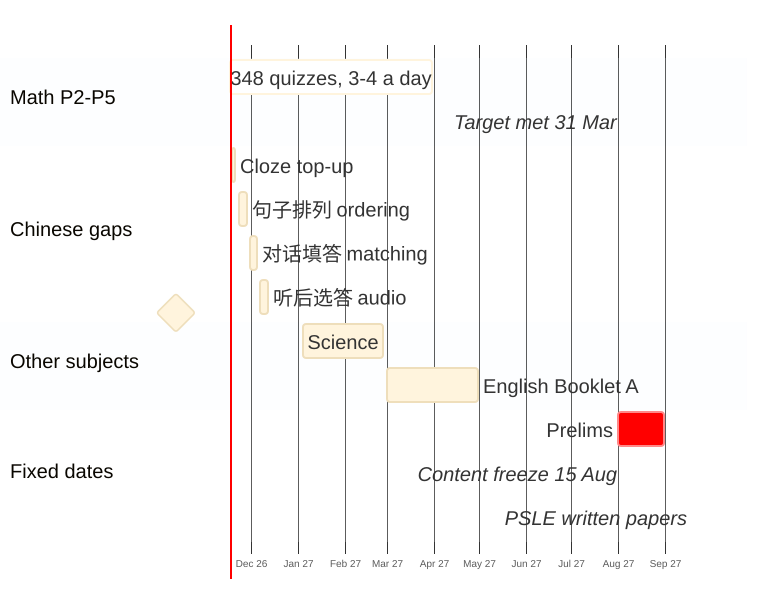

# Roadmap to PSLE 2027

Written 17 Nov 2026. The PSLE written papers are expected around 30 Sep 2027 (confirm against the SEAB circular). This roadmap covers what is still missing from the question banks, how many quizzes Alyssa must complete to master every tier, and the new progression rules. Subjects other than Math and Chinese are planned in `docs/content-schedule.md`.

Every count below comes from `/data/alvin/tmp/cookie-codex/roadmap/count.py`, which reads `site/src/data/syllabus/{math,chinese}.json` and `site/src/data/quiz/{math,chinese}/*.json`. Its full output is in `/data/alvin/tmp/cookie-codex/roadmap/output.txt`; the pace figures come from `pace2.py` in the same folder. Nothing here is estimated except the development days, which use the measured pace: one writer-plus-review cycle gives about 90 reviewed items in about 1 working day of agent time, and each new quiz format costs 2-3 days of UI work.

How the script counts: a tier is a (sub-topic, level) pair, playable at 20 or more questions. A question is filed under the sub-topic of its first outcome. An outcome counts as covered if it appears in any question's `outcomes` list. Only sub-topics holding at least one MCQ-testable outcome have tiers.

## 1. Remaining items

### Summary

| Subject | Sub-topics | Outcomes | Questions | MCQ outcomes with 0 questions | Tiers | Playable | Below 20 | Exactly 20 |
|---|---|---|---|---|---|---|---|---|
| Math | 31 | 181 (172 MCQ-testable) | 4,281 (1,182 with a figure) | 0 | 93 | 93 | 0 | 0 |
| Chinese | 12 | 24 (22 MCQ-testable) | 827 | 4 | 33 | 24 | 9 | 2 |

### Math: nothing to build

Script output: `MCQ outcomes with 0 questions: 0`, `tiers 93; playable 93; below20 0; exactly20 0`. The smallest Math tier holds 25 questions and the largest 100. Math needs 0 development days and no new assets.

One thing the script surfaces and a reader might misread: many single outcomes carry only 2-18 questions (for example `math-whole-numbers-addition-subtraction-multiplication-and-division-05` has 2). That is not a gap, because a tier is graded at sub-topic level and every tier has at least 25 questions. It only means a sub-topic's questions concentrate on a few outcomes. If the owner wants even coverage per outcome, that is a separate, optional quality pass; it is not needed to reach the target.

### Chinese: what is missing

The script confirms all four expected gaps from the data.

| Sub-topic | Tiers (basic / intermediate / competent) | Uncovered outcomes | What is needed | Extra assets | Dev days |
|---|---|---|---|---|---|
| 句子排列 `chi-juzi-order` | 0 / 0 / 0 | `chi-juzi-order-1` | A new ordering quiz format (tap the sentences into order), plus 3 tiers of at least 25 items (about 75) | None | 2-3 UI + 1 content = 3-4 |
| 对话填答 `chi-dialogue-mcq` (完成对话) | 0 / 0 / 0 | `chi-dialogue-mcq-1`, `-2` | A new matching format: 8 phrases into 4 blanks, so it is not a 4-option MCQ. About 75 dialogues across 3 tiers | None | 2-3 UI + 1 content = 3-4 |
| 听后选答 `chi-tingli-text` | 0 / 0 / 0 | `chi-tingli-text-1` | An audio quiz: a player in the quiz runner, plus about 75 items across 3 tiers | About 75 text-to-speech clips (one per item) as static files, each listened to once during review | 2-3 UI + 1 content + 0.5 audio build = 3-4 |
| 多项选择短文填空 `chi-cloze-mcq` (thin cloze) | 20 / 20 / 29 | None uncovered, but `chi-cloze-mcq-1` has only 15 questions | Add at least 5 passages (or blanks) to basic and intermediate to reach 25 each, so one removed question does not make a tier unplayable | None (original passages) | 0.5 |

Script output for the thin tiers, quoted:

```
THIN chi-juzi-order basic 0 / intermediate 0 / competent 0
THIN chi-dialogue-mcq basic 0 / intermediate 0 / competent 0
THIN chi-tingli-text basic 0 / intermediate 0 / competent 0
FRAGILE chi-cloze-mcq basic 20
FRAGILE chi-cloze-mcq intermediate 20
MCQ outcomes with 0 questions: 4
```

Other Chinese outcomes that are covered but light, which the cloze top-up can absorb if the passages are written to hit them: `chi-zixing-form-1` (5 questions), `chi-cloze-mcq-1` (15), `chi-yuedu-mcq-text-2` (16), `chi-ciyu-choose-2` and `-3` (18 each). The sub-topics that hold them all clear 20 per tier, so these are not blocking.

**Chinese total: about 10-13 development days** (three formats at 3-4 days each, plus 0.5 for the cloze top-up). All the 0-question and fragile tiers sit in Paper 2 MCQ types that carry marks (完成对话 is 4 x 2 marks; 听后选答 is a listening MCQ), so this is the work with the highest value per day.

Under the new rules a tier clears when every question in it is mastered, so the size of each bank sets how long a tier takes. The 827 Chinese questions now shipped are 83 quizzes at the minimum, about 103 with retests (+25%, about 1,620 minutes by `TIER_MIN`). The three new formats add about 225 items on top. Chinese has to start early because spaced retests (1, 3 and 7 days) need calendar time, not just minutes.

### Not MCQ-testable: out of scope

These outcomes are flagged `mcqTestable: false` in the syllabus. They stay out of the game.

| Subject | Count | Outcomes |
|---|---|---|
| Chinese | 2 | `chi-yuedu-open-text-1` (answer questions on a practical text and passage), `chi-yuedu-open-text-2` (书面互动, written interaction). Open-ended; the syllabus file also lists composition and the oral papers as non-MCQ components |
| Math | 9 | Drawing and construction tasks: `math-measurement-length-mass-and-volume-03` (measure and draw a line segment), `math-area-and-volume-volume-of-cube-and-cuboid-03` (isometric drawing), `-11` (notation, symbols did not extract from the source), `math-geometry-2d-shapes-04` (copy figures on a grid), `math-geometry-3d-shapes-and-nets-03`, `math-geometry-angles-04` (draw an angle), `math-geometry-perpendicular-and-parallel-lines-02`, `math-geometry-rectangle-and-square-02`, `math-geometry-line-symmetry-03` |

## 2. Science and English

- **Science:** planned for Jan-Feb 2027, not started. See `docs/content-schedule.md`.
- **English:** planned for Mar-Apr 2027 (Booklet A MCQ), listening needs audio and stays out of scope for now. See `docs/content-schedule.md`.

## 3. The pace plan for P1-P5 Math

**Target (owner decision, 17 Nov 2026):** every P1-P5 Math tier cleared to Competent by 31 Mar 2027. A tier is cleared when every question in it is mastered, so clearing now means answering every question in the tier.

### What counts as mastered

- A first-time correct answer retires the question at once.
- A wrong answer retires after its spaced retests (1, 3, then 7 days) all come back correct.
- A quiz is 10 questions: due retests first, then new questions. Correct (already retired) questions are reused only to fill the 10.
- There is no pass percentage and no second pass on another day.

### The count

A sub-topic's P-level is its highest outcome level. `/data/alvin/tmp/cookie-codex/roadmap/pace2.py` finds 23 sub-topics at P2-P5 and none at P1 (the lowest is P2; P1 only appears as individual outcomes inside P2-P5 sub-topics, 20 of them), so the P1-P5 group is those 23 sub-topics and 69 tiers. Script output:

```
subtopics 23 questions by level {'basic': 927, 'intermediate': 927, 'competent': 927} total 2781
```

- **Total: 2,781 questions** across the 69 tiers (927 per level; an average tier has about 40).
- **Minimum quizzes: 2,781 / 10 = 278** (every question seen once and answered correctly).
- **Retests: assumed +25%.** The owner asked for 20-30%. I took the middle: roughly one question in four is answered wrong at first and comes back at least once. The sensitivity is in the table below.

### Quizzes and minutes needed

From 17 Nov 2026 to 31 Mar 2027 is 134 days (19.14 weeks). Minutes use `TIER_MIN` in `site/src/lib/store.ts` as the time for one 10-question quiz: Basic 12, Intermediate 15, Competent 20, so 927 questions at each level cost 927/10 x (12 + 15 + 20) = 4,357 minutes before retests.

| Retests added | Quizzes | Minutes | Hours | Quizzes per week | Minutes per week | Minutes per day, 7 days a week | Minutes per day, 5 days a week |
|---|---|---|---|---|---|---|---|
| 0% (minimum) | 278 | 4,357 | 73 | 14.5 | 228 | 32.5 | 45.5 |
| 20% | 334 | 5,228 | 87 | 17.4 | 273 | 39.0 | 54.6 |
| **25% (assumed)** | **348** | **5,446** | **91** | **18.2** | **284** | **40.6** | **56.9** |
| 30% | 362 | 5,664 | 94 | 18.9 | 296 | 42.3 | 59.2 |

At the assumed 25%: **348 quizzes, about 2.6 a day (3.6 on a 5-day week), and about 41 minutes a day (57 on a 5-day week)**. With extra time on (x1.5) the minutes are 1.5 times higher, so it does not fit.

### Does it fit the 45-minute cap?

Only barely, and only if Alyssa studies every day.

- **Every day, 7 days a week:** 41 minutes at +25% (42 at +30%) fits under the default 45, with 4 minutes to spare. One missed day pushes the rest over.
- **6 days a week:** 47 minutes a day, so the cap needs 50. Set 60.
- **5 days a week:** 57 minutes a day, so the cap needs 60.
- **4 days a week:** 71 minutes a day, so the cap needs 75.
- **3 days a week:** 95 minutes a day, so the cap needs 100.

**Recommendation:** raise the cap to 60 now and plan on 5 study days a week, 3-4 quizzes a day (about 55 minutes). That leaves a rest day without trading away the target. If the parent wants to keep 45, the target holds only with a quiz every day and no missed weeks.

The 5 tries per tier per day are not a limit here: 4 quizzes a day spread over different tiers never reaches 5 on one tier. The daily goal (2 quizzes) is far below the 3-4 needed, so it will not push the routine.

Checkpoints on a straight line at +25% (quizzes completed by the date):

| By | Share of time elapsed | Quizzes done |
|---|---|---|
| 31 Dec 2026 | 33% | about 114 |
| 31 Jan 2027 | 56% | about 195 |
| 28 Feb 2027 | 77% | about 268 |
| 31 Mar 2027 | 100% | 348 |

Because clearing needs the spaced retests, the work cannot be left to the end: a wrong answer on 25 Mar needs its 7-day retest, which falls after 31 Mar. Plan to finish new questions by about 15 Mar, and spend the last two weeks on due retests only.

### Other pools that share the same time

These are not part of the target but compete for the same cap. Same method, +25% retests:

| Pool | Questions | Quizzes | Minutes |
|---|---|---|---|
| P1-P5 Math (target) | 2,781 | 348 | 5,446 |
| P6 Math (8 sub-topics, 24 tiers, 3 tries a day) | 1,500 | 188 | 2,938 |
| Chinese (shipped banks, 3 tries a day) | 827 | 103 | 1,618 |

Once P1-P5 is on schedule, P6 Math and Chinese add about 4,550 minutes (76 hours). That is what the cap and the days a week must absorb after 31 Mar, or alongside the target if the parent raises the cap.

## 4. Progression rules for the parent

| Rule | Before | After (owner decisions, 17 Nov 2026) |
|---|---|---|
| What counts as a pass | At least 80% on a full 10-question tier quiz | **No pass percentage.** A question is mastered when answered correctly |
| How a tier clears | 2 passes on different days, every tier | **Every question in the tier is mastered.** A first-time correct answer retires the question at once; a wrong one retires after its retests (1, 3, then 7 days) come back correct. Same rule for all tiers, P1-P6, Math and Chinese |
| What a quiz is | 10 questions: due retests first (at most 3 from the sub-topic), then new questions, then not-due retests, then retired ones | Still 10 questions: due retests first, then new questions; correct (retired) questions are reused only to fill the 10 |
| When the next tier opens | When the lower tier is cleared | Unchanged: when the lower tier is cleared. Clearing now takes longer, since it means mastering the whole bank |
| Tries per tier per day | 3 | **5 for P1-P5 sub-topics, 3 for P6** (all Chinese sub-topics are P6) |
| Daily goal | 2 quizzes | Not changed by the owner decisions; stays 2 quizzes unless changed later |
| Daily cap | 45 minutes | **45 minutes by default;** the parent can set 45-120 on `/parent/` |
| Where cards come from | Clearing a tier awards its fixed card; a duplicate adds a star (max 5) | Unchanged: clearing a tier awards its fixed card; a duplicate adds a star. Cards now arrive when the whole tier is mastered, not after two passes |

Unchanged for reference: a started quiz counts toward the daily tries, practice papers never retire questions, and the streak counts weeks with 4 or more goal days.

## 5. Timeline



*Figure 1. Timeline to the PSLE. Source: [`img/roadmap-timeline.mmd`](img/roadmap-timeline.mmd); render with `docs/img/render.sh`.*

How to read it:

- **Math P1-P5** runs from today to 31 Mar: 348 quizzes at about 3-4 a day, 5 days a week, with the cap at 60.
- **Chinese gaps** are pulled into Nov-Dec, ahead of the schedule in `docs/content-schedule.md` (which puts the matching format in Jul-Aug). The reason: every Chinese tier must be mastered through spaced retests, so its new tiers need the longest runway, and the bars are 5 working days each, about 10-13 days of agent time in all. This changes the Chinese order in the content schedule; the owner should confirm it.
- **Science and English** follow `docs/content-schedule.md` and are shown for context only.
- **Prelims, the content freeze (15 Aug) and the PSLE** are the fixed dates. Content stops on 15 Aug; September is revision only.

## Decisions for the owner

1. Confirm Chinese Phase 3 formats (ordering, matching, audio) move to Nov-Dec 2026, ahead of the content schedule's Jul-Aug.
2. Confirm the daily cap moves to 60 (or the parent commits to a quiz every day at 45), and that the daily goal stays at 2 quizzes although 3-4 are needed.
3. Confirm 听后选答 uses text-to-speech clips as static files, as the content schedule suggests reconsidering after a text-to-speech pass.
