# Science roadmap: sections to build

Written 2026-11-18. Phase S1 output. This is the build plan for the Science school: every sub-topic to build, how many questions, how many black-and-white figures, and how long it should take. Question types and figure cues come from `docs/syllabus/science-question-patterns.md` (214 papers, 3,339 MCQs). The syllabus is `site/src/data/syllabus/science.json`.

## Figure policy (owner decision)

*Figure 1. Figure policy. Source: [`img/science-figure-policy.mmd`](img/science-figure-policy.mmd); render with `docs/img/render.sh`.*

- **svg:** circuit, graph or chart, table, experimental set-up or apparatus, food web or chain, magnet or force diagram, light or shadow ray diagram. Code-drawn, black and white, exact labels, as in the Math figures (`scripts/quiz/math/figures*.py`).
- **lineart:** a plant, animal, organ or life-cycle stage. AI-generated black-and-white line art with no text in the image. The letters and names are overlaid in HTML, so a label can never be garbled.
- **none:** words only.

## How the numbers are set

- **Sections.** Every Science sub-topic that has an MCQ-testable outcome (34 of the 35). The one left out, `sci-inquiry-communicate` (communicating explanations), is flagged `mcqTestable: false` in the syllabus; it belongs to Booklet B.
- **Questions planned.** At least 25 per tier and 3 tiers (Basic, Intermediate, Competent), so 75 is the floor. Sub-topics whose question types make up 3% or more of the MCQs in the papers get 100; 5% or more get 125; 7% or more get 150. Shares come from the catalogue.
- **svg figures.** Planned questions times the type's figure-cue share times the svg part of its figures. This counts figure instances (a circuit drawn for each question). One drawing routine serves many questions, so the effort is in the routines, not the count.
- **lineart figures.** The same count for lineart, divided by 3 and rounded up, because one image (a flower, a digestive system) serves about three questions with different labels. This is the number of images to generate.
- **Types with no figure.** Types the catalogue marks `none` (living characteristics, population and community, human impact, respiration and the Sun) plan no figure, even though about half of their paper items carry a decorative picture.
- **Days.** One person working with the existing toolkit: curated questions at 80 a day and parametric questions at 150 a day (both include the independent checker), 0.35 day per distinct svg drawing routine in the sub-topic, 120 svg instances placed and checked per day, 25 lineart images per day (prompt, pick, confirm no text, write the label overlay). These rates are estimates, not measurements (unverified). Math and English measured rates can replace them once Science starts.

## Sections to build

P = highest syllabus level of the sub-topic. Types are catalogue ids (without `sci-pat-`).

| Topic | Sub-topic | P | Types in catalogue | Questions (B / I / C) | svg | lineart | Days |
|---|---|---|---|---|---|---|---|
| **Diversity of Living and Non-Living Things (General characteristics and classification)** | | | | **200** | **56** | **8** | **4.0** |
| | Characteristics of living things (`diversity-living-characteristics`) | P3 | living-characteristics | 75 (25 / 25 / 25) | 0 | 0 | 0.9 |
| | Broad groups of living things (`diversity-living-classification`) | P3 | classify-groups | 125 (41 / 41 / 43) | 56 | 8 | 3.0 |
| **Diversity of Materials** | | | | **100** | **88** | **0** | **2.7** |
| | Properties and uses of materials (`diversity-materials-properties`) | P3 | material-properties | 100 (33 / 33 / 34) | 88 | 0 | 2.7 |
| **Cycles in Plants and Animals (Life Cycles)** | | | | **75** | **10** | **19** | **2.1** |
| | Life cycles of plants and animals (`cycles-life-cycles-compare`) | P3 | life-cycle-stages | 75 (25 / 25 / 25) | 10 | 19 | 2.1 |
| **Cycles in Plants and Animals (Reproduction)** | | | | **300** | **52** | **61** | **7.7** |
| | Cell and continuity of kind (`cycles-repro-cell`) | P5 | cell-continuity | 100 (33 / 33 / 34) | 22 | 18 | 2.5 |
| | Plant reproduction (`cycles-repro-plants`) | P5 | plant-reproduction | 125 (41 / 41 / 43) | 30 | 24 | 3.5 |
| | Human reproduction (`cycles-repro-humans`) | P5 | human-reproduction | 75 (25 / 25 / 25) | 0 | 19 | 1.7 |
| **Cycles in Matter and Water (Matter)** | | | | **150** | **122** | **0** | **2.7** |
| | Matter and states of matter (`cycles-matter-states`) | P4 | states-of-matter | 150 (50 / 50 / 50) | 122 | 0 | 2.7 |
| **Cycles in Matter and Water (Water)** | | | | **275** | **210** | **0** | **6.1** |
| | States of water and changes of state (`cycles-water-states`) | P5 | change-of-state | 125 (41 / 41 / 43) | 99 | 0 | 3.1 |
| | Rate of evaporation (`cycles-water-evaporation`) | P5 | evaporation-rate | 75 (25 / 25 / 25) | 60 | 0 | 1.4 |
| | Water cycle and conservation (`cycles-water-cycle`) | P5 | water-cycle | 75 (25 / 25 / 25) | 51 | 0 | 1.7 |
| **Plant System (Plant parts and functions)** | | | | **125** | **30** | **24** | **3.1** |
| | Parts of a plant (`systems-plant-parts-fn`) | P4 | plant-parts-function | 125 (41 / 41 / 43) | 30 | 24 | 3.1 |
| **Human System (Digestive system)** | | | | **175** | **24** | **36** | **5.2** |
| | Overview of human systems (`systems-human-overview`) | P4 | shared: digestive-system, resp-circulatory | 75 (25 / 25 / 25) | 13 | 15 | 2.7 |
| | Digestive system (`systems-digestive-parts`) | P4 | digestive-system | 100 (33 / 33 / 34) | 11 | 21 | 2.5 |
| **Human System (Respiratory and circulatory systems)** | | | | **175** | **61** | **18** | **4.5** |
| | Gases in air (`systems-air-gases`) | P5 | gases-in-air | 75 (25 / 25 / 25) | 38 | 0 | 1.6 |
| | Respiratory and circulatory systems (`systems-resp-circ-parts`) | P5 | resp-circulatory | 100 (33 / 33 / 34) | 23 | 18 | 2.9 |
| **Plant System (Respiratory and circulatory systems)** | | | | **75** | **33** | **12** | **2.0** |
| | Plant transport system (`systems-plant-transport-parts`) | P5 | plant-transport | 75 (25 / 25 / 25) | 33 | 12 | 2.0 |
| **Electrical System** | | | | **225** | **210** | **0** | **4.7** |
| | Electric circuits (`systems-circuit`) | P5 | circuit-basics | 150 (50 / 50 / 50) | 135 | 0 | 2.8 |
| | Variables affecting current; conductors (`systems-circuit-vars`) | P5 | circuit-variables | 75 (25 / 25 / 25) | 75 | 0 | 1.8 |
| **Interaction of Forces (Magnets)** | | | | **100** | **90** | **0** | **2.5** |
| | Magnets (`interactions-magnet-props`) | P3 | magnet-properties | 100 (33 / 33 / 34) | 90 | 0 | 2.5 |
| **Interaction of Forces (Frictional force, gravitational force, elastic spring force)** | | | | **175** | **141** | **0** | **5.0** |
| | Forces and their effects (`interactions-forces-effects`) | P6 | forces-effects | 100 (33 / 33 / 34) | 70 | 0 | 2.5 |
| | Friction, elastic spring force, weight (`interactions-forces-investigate`) | P6 | friction-spring-weight | 75 (25 / 25 / 25) | 71 | 0 | 2.5 |
| **Interactions within the Environment** | | | | **250** | **96** | **5** | **5.5** |
| | Factors affecting survival; food chains (`interactions-env-survival`) | P6 | food-chain-web | 100 (33 / 33 / 34) | 90 | 0 | 3.0 |
| | Organism, population, community, habitats (`interactions-env-community`) | P6 | population-community | 75 (25 / 25 / 25) | 0 | 0 | 0.9 |
| | Adaptations and human impact (`interactions-env-adapt`) | P6 | adaptations, human-impact | 75 (25 / 25 / 25) | 6 | 5 | 1.5 |
| **Energy Forms and Uses (Light)** | | | | **75** | **57** | **0** | **2.0** |
| | Seeing and shadows (`energy-light-seeing`) | P4 | light-shadows | 75 (25 / 25 / 25) | 57 | 0 | 2.0 |
| **Energy Forms and Uses (Heat)** | | | | **200** | **153** | **0** | **4.7** |
| | Heat and temperature (`energy-heat-temp`) | P4 | heat-temperature | 125 (41 / 41 / 43) | 98 | 0 | 2.7 |
| | Effects of heat and conductors (`energy-heat-effects`) | P4 | heat-effects-conductors | 75 (25 / 25 / 25) | 55 | 0 | 2.0 |
| **Energy Forms and Uses (Photosynthesis)** | | | | **150** | **55** | **0** | **3.0** |
| | Respiration and the Sun (`energy-photo-respiration`) | P6 | respiration-sun | 75 (25 / 25 / 25) | 0 | 0 | 0.9 |
| | Photosynthesis (`energy-photo-requirements`) | P6 | photosynthesis | 75 (25 / 25 / 25) | 55 | 0 | 2.1 |
| **Energy Conversion** | | | | **100** | **72** | **0** | **1.6** |
| | Forms and conversion of energy (`energy-conv-forms`) | P6 | energy-conversion | 100 (33 / 33 / 34) | 72 | 0 | 1.6 |
| **Scientific inquiry skills assessed in PSLE (AO II b)** | | | | **250** | **231** | **0** | **7.1** |
| | Predicting and hypothesising (`inquiry-predict-hyp`) | P3 | shared: fair-test-design, read-data | 75 (25 / 25 / 25) | 69 | 0 | 2.8 |
| | Interpreting and analysing information (`inquiry-analyse`) | P3 | read-data | 100 (33 / 33 / 34) | 100 | 0 | 2.5 |
| | Evaluating observations, information and methods (`inquiry-evaluate`) | P5 | fair-test-design | 75 (25 / 25 / 25) | 62 | 0 | 1.7 |
| **Total** | **34 sub-topics** | | | **3,175** | **1,791** | **183** | **76** |

Totals: **34 sub-topics, 3,175 questions, 1,791 svg figures, 183 lineart images (for about 530 lineart questions), about 76 days.** For comparison, the Math school holds 4,281 questions and the English school 446.

The questions split three ways inside a sub-topic; where 75 does not divide evenly the last tier takes the remainder. Tier sizes are floors: a tier with 25 questions is playable but fragile, so any extra questions should go to the Competent tier first.

## Cost by effort type

| Part | Days |
|---|---|
| questions | 31.7 |
| svg routines | 22.4 |
| svg instances | 14.9 |
| lineart images | 7.3 |
| **Total** | **76.3** |

## Recommended order

The three topics that need the fewest figures (svg figures plus lineart images) are:

1. **Cycles in Plants and Animals (Life Cycles)**: 29 figures (10 svg, 19 lineart), 75 questions, about 2.1 days.
2. **Plant System (Respiratory and circulatory systems)**: 45 figures (33 svg, 12 lineart), 75 questions, about 2.0 days.
3. **Plant System (Plant parts and functions)**: 54 figures (30 svg, 24 lineart), 125 questions, about 3.1 days.

Together: 275 questions, 128 figures, about 7 days. Each is a single sub-topic of 75 to 125 questions, so the figure count is low partly because the topic is small; per question they need about the same share of figures as the rest.

The honest catch is that all three are lineart-led (plants and life cycles), so building them first is also the first test of the AI line-art step: confirm that generated drawings carry no text, stay black and white, and take HTML labels cleanly, before committing the other 150-odd images. If that step is not ready, start with the topics that need only svg and no lineart at all:

1. **Energy Forms and Uses (Photosynthesis)**: 55 svg figures, 150 questions, about 3.0 days.
2. **Energy Forms and Uses (Light)**: 57 svg figures, 75 questions, about 2.0 days.
3. **Energy Conversion**: 72 svg figures, 100 questions, about 1.6 days.

## Fit with the schedule

`docs/content-schedule.md` gives Science Jan to Feb 2027, about 40 working days. The estimate above is about 76 days for one person, so it does not fit in that window as one block. Options, in order of preference: build the three recommended topics and the svg-only topics first (they carry the circuits, heat, forces and matter items that make up about half of the paper); push the remaining lineart-heavy topics (reproduction, systems) into the June holidays fill-in slot; and keep each sub-topic at 75 questions until its tiers are playable, then top up. The highest-frequency sub-topics by item share are electric circuits, states of matter, changes of state, plant parts, heat, plant reproduction and classification, so those matter most for revision value.

## Not built

- `sci-inquiry-communicate` (communicating explanations and reasoning): not MCQ-testable, Booklet B only.
- Foundation Science (SEAB 0039) is a separate paper and is out of scope.
- Open-ended Booklet B questions of any topic.
